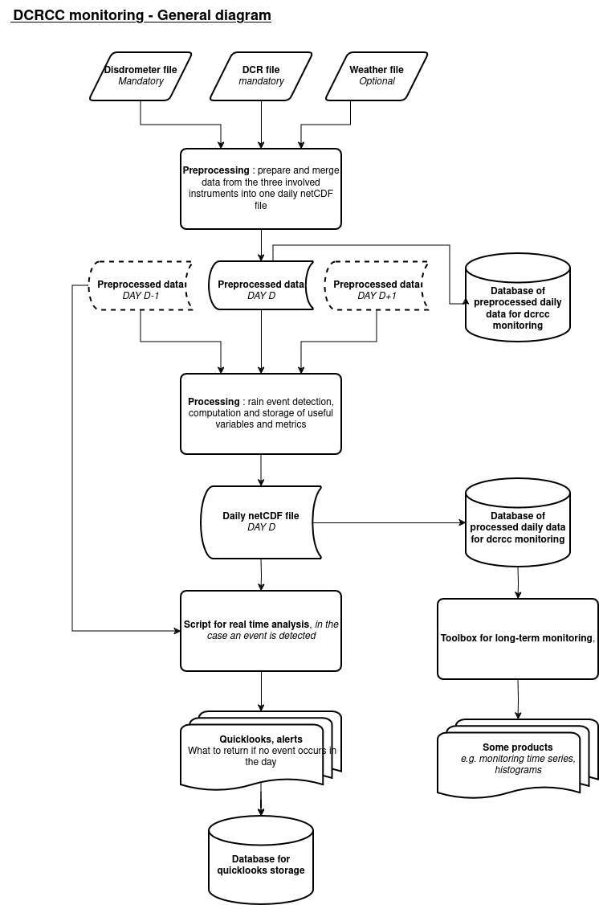

# How to

## General diagram of the code

 
General diagram of the DCR calibration constant monitoring code

 <!-- 
-->

:::

## Different command lines available in the package

:::

   | **Command** | **Description** |
   |------|------|
   |   `preprocess`   |   Preprocess daily data from CLU daily instruments files : outputs a preprocessing file   |
   |   `preprocess-ql`   |   Generates daily quicklooks at specified paths from daily preprocessing file + a configuration file   |
   |   `process`   |   Outputs a daily processing file from a daily preprocesing file and the neighbouring days' preprocessing files   |
   |   `process-ql`   |   Generates quicklooks focusing on detected rain events at specified paths from daily processing file and the neighbouring day's preprocessing files + configuration file   |
   |      |      |


## Content of the config file that drives the data processing

Every parameter of the preprocessing, the processing, the quicklooks and `gate_check` is read in the station configuration file : the code holds no default value. Each command checks the file before reading any data and stops with the list of every missing key, unknown key (an obsolete or misplaced one) or invalid value. The station files of the network are in the `conf_stations` folder of [ccres_disdro_config](https://github.com/ACTRIS-CCRES/ccres_disdro_config).

| **Section** | **Step** | **Content** |
|------|------|------|
| `[location]` | all | site and station names |
| `[methods]` | preprocessing | fall speed and axis ratio models, highest radar altitude read |
| `[instrument_parameters]` | all | disdrometer sampling area and orientation, ΔZ gate (`DCR_DZ_RANGE`) and gates kept (`PROCESSING_RANGES`), what the disdrometer time marks (`DD_TIMESTAMP_CONVENTION`, `"end"` or `"start"`), dielectric factor of the radar (`KW_SQR` : 0.93 in X band, 0.88 in Ka band, 0.74 in W band) ; `AU` and `DD_SAMPLING_AREA_DEFAULT` (Thies) are informative only |
| `[thresholds]` | processing | event selection and quality checks ; `MIN_POINTS` : QC-passed minutes for an event to be plotted by `process-ql --flag` and used by `gate_check` |
| `[disdrometer_interval]` | preprocessing | interval assumed when the file gives none, longest telegram kept, shortest telegram not flagged |
| `[disdrometer_axis_check]` | preprocessing | check of the Parsivel `data_raw` axis order on the fall speeds |
| `[radar_alignment]` | preprocessing | radar window over each disdrometer telegram, advanced by `FALL_TIME_FACTOR` × range / \|v\| |
| `[saturation]` | preprocessing (`QF_saturation`) and processing (`QC_sat`) | detection of the radar receiver ceiling from the SNR (MIRA), margin `ZDD_MARGIN` below it |
| `[gate_check]` | `gate_check` | reference layer (also the layer the radar reflectivity is normalised over, for the radar-only check of the gate), tolerance, bootstrap, and the stratiform selection levels `[gate_check.levels.<name>]`, from the most lenient to the most demanding |
| `[nc_meta]` | preprocessing, processing | global attributes of the output files |

A change in a preprocessing section only applies to files preprocessed again.

`REFRACTION_INDEX`, `RADAR_FREQUENCIES`, `COMPUTE_MIE_METHOD` and `PR_SAMPLING`, found in older configuration files, are no longer accepted : the scattering is computed at the radar's own frequency, read in the radar file, with the water refractive index of `ccres_disdrometer_processing/assets/water_dielectric.toml` (see the preprocessing page), and the weather station sampling is found from its data.

Here is an example of a configuration file (Palaiseau, with a *BASTA* radar and a *Thies* disdrometer)

```toml
title = "Configuration for the computation of the dcrcc monitoring (preprocessing and processing) at Palaiseau"

[location]
SITE = "Palaiseau"
STATION = "SIRTA" # useful for plots

[methods]
FALL_SPEED_METHOD = "GunAndKinzer"
AXIS_RATIO_METHOD = "BeardChuang_PolynomialFit"
MAX_ALTITUDE_RADAR_DATA = 2500

[instrument_parameters]
AU = 965
DD_SAMPLING_AREA_DEFAULT = 0.0046
DD_SAMPLING_AREA = 0.004439 # m^2 ; = SAMPLING_AREA_DEFAULT*AU/1000
DCR_DZ_RANGE = 300 # m ; height at which to compute Delta Z
PROCESSING_RANGES = [100, 200, 300]
DD_ORIENTATION = 0 # degree, from North
DD_TIMESTAMP_CONVENTION = "end" # the time written marks the end of the measurement interval
KW_SQR = 0.74 # |K|^2 the radar uses to compute Ze ; W band, |K| = 0.86 (Toledo and Delanoe)

[plot_parameters]

[thresholds]
MAX_RR = 3  # mm/h
MIN_RAINFALL_AMOUNT = 3 # mm/episode
MAX_WS = 10 # m/s ; max wind to keep a timestep
MIN_TEMP = 2 # °C
MIN_HUR = 80 # min relative humidity : avoid cases with evaporation
MAX_HUR = 99 # max relative humidity : avoid fog, ...
DD_ANGLE = 45 # degree ; keep wind data at DD_ORIENTATION[pi] +- DD_ANGLE
MAX_INTERVAL = 60 # mn ; max interval between two tipping of the pluviometer, to "close" an event
MIN_DURATION = 180 # mn ; min duration of an event
DD_RG_MAX_PR_ACC_RATIO = 0.3 # ex ACCUMULATION_RELATIVE_ERROR ; max relative error in rain accumulation measurement, DD vs Rain gauge
DD_FALLSPEED_RATIO = 0.3 # ex FALLSPEED_RELATIVE_ERROR ; relative difference between "theoretical" and DD fall speed
MIN_POINTS = 50

[disdrometer_interval] # preprocessing : measurement interval of the telegrams
NOMINAL_INTERVAL = 60.0 # s ; interval assumed when the file gives none
MAX_TELEGRAM_INTERVAL = 90.0 # s ; longer telegrams cover a data gap and are dropped
MIN_FULL_INTERVAL = 30.0 # s ; shorter telegrams are kept, normalised by their interval, and flagged

[disdrometer_axis_check] # preprocessing : Parsivel data_raw axis order checked on the fall speeds
MIN_DROPS = 2000 # drops of 0.5-4 mm over the day needed for the check
RATIO = 0.5 # the order kept must have a misfit below RATIO times the other one

[radar_alignment] # preprocessing : radar median over each disdrometer telegram (Zdcr_aligned)
FALL_TIME_FACTOR = 0.55 # window advanced by FALL_TIME_FACTOR x range / |v|
MIN_FALL_SPEED = 0.5 # m/s ; slower gates (no rain) are not used for |v|
MIN_WINDOW_COVERAGE = 0.6 # share of the typical number of profiles a window needs
RADAR_WINDOW = 60.0 # s ; duration of the radar window

[saturation] # preprocessing (QF_saturation) and processing (QC_sat) ; radars with SNR only (MIRA)
SNR_CAP_MIN = 50.0 # dB ; lowest SNR ceiling taken as a saturation
ZDD_MARGIN = 4.0 # dB ; flag 2 when Zdd >= reflectivity ceiling - ZDD_MARGIN
MINUTE_FRACTION = 0.1 # a minute is at the ceiling when this share of its profiles is
CAP_RANK = 20 # the day's ceiling is the CAP_RANK-th largest SNR of the gate
NEAR_DB = 1.0 # dB ; profiles within NEAR_DB of the ceiling are at the ceiling
BAND_DB = [2.0, 4.0] # dB ; comparison band below the ceiling
MIN_PROFILES = 200 # profiles of the day needed to assess a gate
N_STRONG = 300 # profiles at the ceiling enough for a saturation
N_MIN = 100 # or N_MIN profiles at the ceiling, with RATIO_MIN times more than in BAND_DB
RATIO_MIN = 1.5

[gate_check] # gate_check tool (MIN_POINTS of [thresholds] is used as well)
R_MAX = 1000.0 # m ; highest gate read (the selection uses Z and |v| at 900 m)
R_SEARCH = 600.0 # m ; top of the reference layer
R_REF = 350.0 # m ; bottom of the reference layer
TOL = 0.25 # dB ; tolerance around the reference line
MIN_EVENTS = 15 # events wanted in the selection
MIN_EVENTS_PERIOD = 8 # events for a period to be assessed (looser level if need be)
N_BOOT = 200 # bootstrap draws of the events
BOOT_QUANTILE = 0.8 # quantile of the drawn gates recommended
DV_RATIO = 0.7 # gates slower than this share of the lowest ones are left out (melting layer)

# stratiform selection levels, from the most lenient to the most demanding :
# n_qc, rain_frac, qc_frac, dv_ratio, dv_lo are lower bounds, the others upper bounds
[gate_check.levels.large]
n_qc = 180
rain_frac = 0.70
qc_frac = 0.55
lpr_std = 0.60
pr_p95 = 2.7
z5_jump = 1.5
dv_ratio = 0.85
dv_lo = 2.5
z_grad = 1.5

[gate_check.levels.moyen]
n_qc = 240
rain_frac = 0.80
qc_frac = 0.65
lpr_std = 0.55
pr_p95 = 2.5
z5_jump = 1.0
dv_ratio = 0.90
dv_lo = 3.0
z_grad = 1.0

[gate_check.levels.exigeant]
n_qc = 270
rain_frac = 0.825
qc_frac = 0.70
lpr_std = 0.50
pr_p95 = 2.25
z5_jump = 1.0
dv_ratio = 0.90
dv_lo = 3.0
z_grad = 1.0

[gate_check.levels.strict]
n_qc = 300
rain_frac = 0.85
qc_frac = 0.75
lpr_std = 0.45
pr_p95 = 2.0
z5_jump = 1.0
dv_ratio = 0.90
dv_lo = 3.0
z_grad = 1.0

[nc_meta]
title = ""
summary = ""
id = ""
naming_authority = ""
comment = ""
creator_name = "ACTRIS-CCRES"
creator_email = "ccres_contact@listes.ipsl.fr"
creator_url = "https://ccres.aeris-data.fr"
creator_type = "institution"
creator_institution = ""
institution = ""
project = ""
publisher_name = ""
publisher_email = ""
publisher_url = ""
publisher_type = ""
publisher_institution = ""
contributor_name = ""
contributor_role = ""
cdm_data_type = ""
metadata_link = ""
```


## Preprocessing command


    ccres_disdrometer_processing preprocess --disdro-file DISDRO_FILE [--ws-file WS_FILE] --radar-file RADAR_FILE --config-file CONFIG_FILE [-v] OUTPUT_FILE

| **Short** | **Long** | **Default** | **Description** |
|------|------|------|------|
|      |   `--disdro-file`   |      |   CLU netCDF disdrometer file for the day to process   |
|      |   `--ws-file`   |   None   |   CLU netCDF weather station file for the day to process   |
|      |   `--radar-file`   |      |   CLU netCDF DCR file for the day to process   |
|      |   `--config-file`   |      |   TOML configuration file suited for the input data (site, instruments, ...)   |
|   `-v`   |      |   0   |   Verbosity   |
|      |      |      |      |

## Preprocessing quicklooks command

    ccres_disdrometer_processing preprocess-ql --config-file CONFIG_FILE FILE OUTPUT_QL_OVERVIEW OUTPUT_QL_OVERVIEW_ZH

| **Short** | **Long** | **Default** | **Description** |
|------|------|------|------|
|      |   `--config-file`   |      |   TOML configuration file suited for the input data (site, instruments, ...)   |
|      |   `file`   |      |   Output of preprocessing for the day to be displayed   |
|      |   `output-ql-overview`   |      |   Path to save the first panel of quicklooks (overview and met variables)   |
|      |   `output-ql-overview-zh`   |      |   Path to save the second panel of quicklooks (time series of DCR and DD reflectivity)   |
|      |      |      |      |


## Processing command


    ccres_disdrometer_processing process [--yesterday YESTERDAY_FILE] --today TODAY_FILE [--tomorrow TOMORROW_FILE] --config-file CONFIG_FILE [--no-meteo] [-v] OUTPUT_FILE

| **Short** | **Long** | **Default** | **Description** |
|------|------|------|------|
|      |   `--yesterday`   |   None   |   Output of preprocessing for the day before the day to be processed   |
|      |   `--today`   |      |   Output of preprocessing for the day to be processed   |
|      |   `--tomorrow`   |   None   |   Output of preprocessing for the day before the day to be processed   |
|      |   `--config-file`   |      |   TOML configuration file suited for the input data (site, instruments, ...)   |
|      |   `--no-meteo`   |   False   |   Boolean : set to True to downgrade the processing i.e. to dispense with weather data even if it is provided in input preprocessing files   |
|   `-v`   |      |   0   |   Verbosity   |
|      |      |      |      |

## Processing quicklooks command

    ccres_disdrometer_processing process-ql [--process-yesterday PROCESS_YESTERDAY] --process-today PROCESS_TODAY [--preprocess-yesterday PREPROCESS_YESTERDAY] --preprocess-today PREPROCESS_TODAY [--preprocess-tomorrow PREPROCESS_TOMORROW] --prefix-output-ql-summary PREFIX_OUTPUT_QL_SUMMARY --prefix-output-ql-detailled PREFIX_OUTPUT_QL_DETAILLED --config-file CONFIG_FILE [--flag | --no-flag]

| **Short** | **Long** | **Default** | **Description** |
|------|------|------|------|
|      |   `--process-yesterday`   |      |   Output of processing for the day before the day  for which we want to plot rain events   |
|      |   `--process-today`   |      |   Output of processing for the day for which we want to plot rain events   |
|      |   `--preprocess-yesterday`   |      |   Output of preprocessing for the day before the day  for which we want to plot rain events   |
|      |   `--preprocess-today`   |      |   Output of preprocessing for the day  for which we want to plot rain events   |
|      |   `--preprocess-tomorrow`   |      |   Output of preprocessing for the day before the day  for which we want to plot rain events   |
|      |   `--prefix-output-ql-summary`   |      |   Path to save the first panel of quicklooks (summary panel)   |
|      |   `--prefix-output-ql-detailled`   |      |   Path to save the second panel of quicklooks (panel with detaileld analysis)   |
|      |   `--config-file`   |      |   TOML configuration file suited for the input data (site, instruments, ...)   |
|      |   `--flag` / `--no-flag`   |   `--flag`   |   With `--flag`, plots only events which pass the Quality Flags specified in processing file and hold at least `MIN_POINTS` QC-passed timesteps (configuration file); with `--no-flag`, plots every event |
|      |      |      |      |
